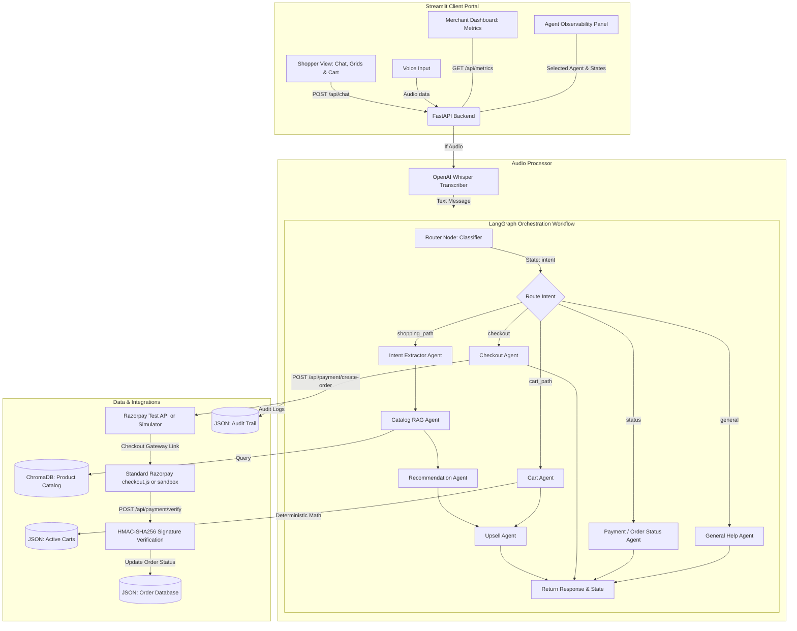

# AgentForge Commerce

**AgentForge Commerce** is an agentic AI sales and checkout engine designed to convert natural-language buyer intent into a bounded, explainable purchase and checkout workflow. Built for the **Razorpay AI Buildathon 2026 (Track 1: AI Growth & Agentic Commerce)**, it demonstrates how modern merchants can become AI-readable and AI-transactable.

<div align="center">


**An Agentic Commerce Engine transforming conversational buyer intent into secure purchases via Razorpay Test Mode checkout.**

</div>

---

## 🎯 Why This Project Matters

Traditional e-commerce relies on users manually browsing catalogs, adding items to lists, and manually clicking checkout. **AgentForge Commerce** pioneers the shift to agentic commerce:

$$\text{Intent} \longrightarrow \text{Reasoning} \longrightarrow \text{Retrieval} \longrightarrow \text{Recommendation} \longrightarrow \text{Action} \longrightarrow \text{Payment} \longrightarrow \text{Verification}$$

The shopping assistant does not just chat: it uses tools to search catalogs, updates carts, offers upsells, and initiates payments, while enforcing critical safety bounds.

---

## ✨ Key Features

*   **Agentic Product Discovery & RAG:** Uses persistent ChromaDB vector databases to retrieve product recommendations based on budget, category, and preferences.
*   **Contextual Cross-Sell / Upsell:** Suggests compatible, in-stock complementary items to increase Average Order Value (AOV).
*   **Deterministic Cart & Pricing:** Calculates subtotal, discounts, 18% GST, and shipping fees strictly on the backend to prevent LLM calculations and hallucinations.
*   **Razorpay Standard Test Checkout:** Server-side order creation and signature verification (HMAC-SHA256). Includes a visual sandbox payment simulation if credentials are missing.
*   **Payment Safety Guardrail:** The AI cannot spend money; it prepares carts and checkouts, but the user must explicitly confirm to open the payment gateway.
*   **Agent-Readable Catalog API & AI Buyer Mode:** Advertises capabilities at `/api/agent/capabilities` allowing simulated autonomous AI buyers to discover and transact.
*   **Merchant Observability Dashboard:** Real-time business metrics (conversations, searches, successful checkouts, AOV, revenue) computed dynamically from logs.
*   **Agent Trace Panel:** Interactive panel visualizing the LangGraph node routing and decision states for transparency.
*   **Voice Shopping Mode:** Speech-to-text (**OpenAI Whisper**) and text-to-speech (**Edge-TTS**) for a hands-free shopping experience.

---

## 🛠️ System Architecture



---

## 📂 Project Structure

```text
AgentForge-AI/
│
├── backend/                  # FastAPI Backend Server
│   ├── .env                  # API keys and local configuration
│   ├── main.py               # FastAPI server entry point & API endpoints
│   ├── workflow.py           # LangGraph orchestration flow and state
│   ├── agent.py              # LLM client configuration
│   ├── tools.py              # Tool bindings
│   │
│   ├── agents/               # Specialized Graph Agent Personas
│   │   ├── router_agent.py   # State router
│   │   └── commerce_agents.py # Intent extraction, Recommendations, and Upsells
│   │
│   ├── services/             # Core Commerce Business Services
│   │   ├── catalog_service.py # In-memory and ChromaDB catalog queries
│   │   ├── cart_service.py    # Deterministic cart calculations
│   │   ├── razorpay_service.py # Order creation, verification, and simulator
│   │   ├── audit_service.py   # Persistent JSON audit logging
│   │   └── evaluation_service.py
│   │
│   ├── templates/            # HTML Templates
│   │   └── checkout.html     # Razorpay standard checkout wrapper
│   │
│   └── chroma_db/            # ChromaDB product embeddings collection
│
├── frontend/                 # Streamlit Frontend Client
│   └── app.py                # Redesigned Shopper, Dashboard, Trace, and AI Buyer UI
│
├── data/                     # Persistent JSON Databases
│   ├── products.json         # Synthetic merchant catalog (60 products)
│   ├── carts.json            # Active session carts
│   ├── orders.json           # Created orders database
│   └── audit_logs.json       # Audit logs trail
│
├── scripts/                  # Scripts
│   ├── generate_products.py  # Generates data/products.json
│   ├── ingest_catalog.py     # Embeds products.json into ChromaDB
│   └── run_evaluation.py     # Runs 30 scenarios evaluation suite
│
├── tests/                    # Unit Tests
│   ├── run_tests.py          # Unit test runner
│   ├── test_catalog.py
│   ├── test_cart.py
│   ├── test_payments.py
│   └── test_agents.py
│
├── requirements.txt          # Python dependencies
├── .env.example              # Environment variables template
└── README.md                 # Project documentation
```

---

## 🚀 Setup Instructions

### 1. Prerequisites
Ensure you have **Python 3.10+** installed on your system. You will need API keys for:
* Google Gemini (`GOOGLE_API_KEY`)
* Tavily Search (`TAVILY_API_KEY`)
* (Optional) Razorpay Test Mode Key & Secret (`RAZORPAY_KEY_ID`, `RAZORPAY_KEY_SECRET`)

### 2. Installation
```bash
# Clone the repository
git clone https://github.com/Abhiprameesh/AgentForge-AI.git
cd AgentForge-AI

# Create and activate a virtual environment
python -m venv .venv
# On Windows:
.venv\Scripts\activate
# On Mac/Linux:
source .venv/bin/activate

# Install required dependencies
pip install -r requirements.txt
```

### 3. Environment Variables
Create a `.env` file in the `backend/` directory or root workspace. Follow `.env.example`:
```env
GOOGLE_API_KEY=your_gemini_api_key
TAVILY_API_KEY=your_tavily_api_key

# Optional (Leave blank to use payment simulator sandbox)
RAZORPAY_KEY_ID=
RAZORPAY_KEY_SECRET=
RAZORPAY_WEBHOOK_SECRET=
```

### 4. Database Ingestion
Generate and populate the ChromaDB product catalog vector collection:
```bash
# Generate synthetic catalog data
python scripts/generate_products.py

# Ingest and embed products into ChromaDB
python scripts/ingest_catalog.py
```

### 5. Running the Application
Open two separate terminals and activate the virtual environment.

**Terminal 1: Start the FastAPI Backend**
```bash
cd backend
uvicorn main:app --reload
```

**Terminal 2: Start the Streamlit Frontend**
```bash
cd frontend
streamlit run app.py
```

---

## 🧪 Testing & Evaluation

### Running Unit Tests
Validate that all components (catalog search, cart logic, signature checks, and LangGraph routing) function correctly:
```bash
python tests/run_tests.py
```

### Running the Evaluation Suite
Evaluate 30 synthetic scenarios measuring intent accuracy, budget adherence, and hallucination rates:
```bash
python scripts/run_evaluation.py
```

---

## 🔒 Security & Bounded Action Policy

1.  **Strict Action Gate:** The AI can only search catalogs, suggest items, update carts, and prepare checkouts. It cannot invoke payments. The payment order is only created, and checkout gateway opened, when the user explicitly clicks a confirmation button.
2.  **Deterministic Pricing:** All calculations (subtotal, discounts, shipping, taxes) are computed by the backend using strict Python floating-point math, entirely isolated from the LLM, neutralizing price manipulation vectors.
3.  **Signature Verification:** All successful payments are verified server-side using HMAC-SHA256 hashing of `razorpay_order_id | razorpay_payment_id` against the server's `RAZORPAY_KEY_SECRET`. No payments are registered without verification.
4.  **No Exposed Credentials:** Secret keys and webhook tokens remain entirely server-side in the backend environment. They are never transmitted or exposed to the frontend.

---

## 📜 License
This project is licensed under the MIT License.
